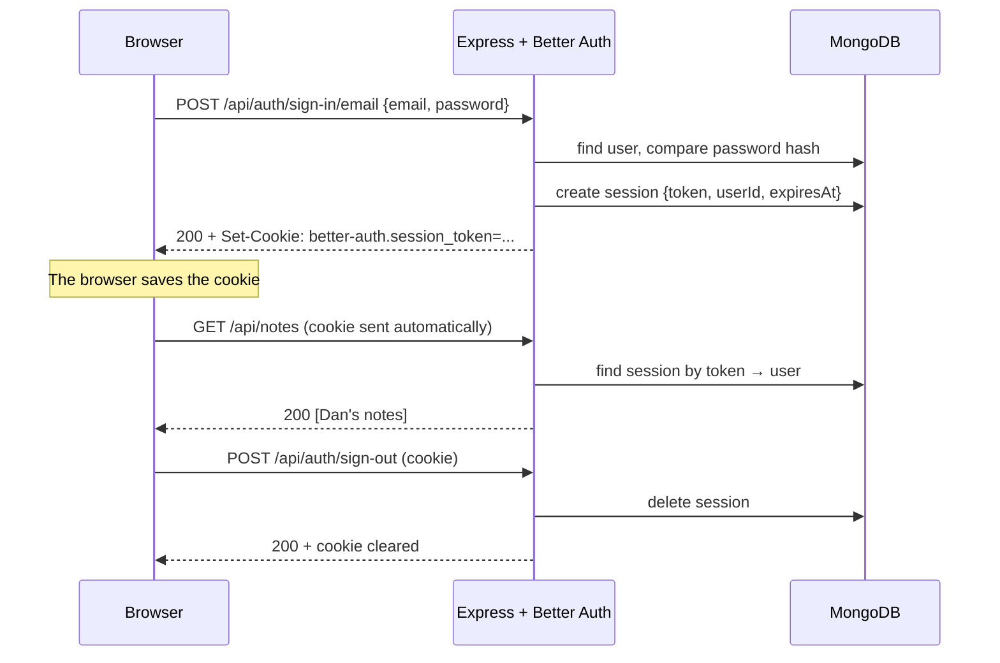

# 1. How authentication works

[Next: the backend →](02-backend.md) · [עברית](../he/01-how-auth-works.md)

This page explains the ideas. The next pages show the code.

## Two different questions

| Word               | Question                        | Example                                   | Wrong answer → |
| ------------------ | ------------------------------- | ----------------------------------------- | -------------- |
| **Authentication** | *Who are you?*                  | Signing in with email and password        | `401 Unauthorized` |
| **Authorization**  | *What are you allowed to do?*   | Only a manager may archive a note         | `403 Forbidden`    |

First the server finds out **who** sent the request. Then it decides whether
that user **may** do what they asked.

## The pieces

```
Browser (React)                Vite dev server            Express (port 3000)            MongoDB
───────────────                ───────────────            ───────────────────            ───────
authClient.signIn.email() ──▶  /api/* is forwarded  ──▶   /api/auth/*  → Better Auth ──▶  user, account,
fetch('/api/notes')       ──▶  to port 3000         ──▶   /api/notes   → requireAuth      session
```

- **Better Auth** is the library that does the hard parts: signing up, hashing
  passwords, creating sessions, cookies, roles. We configure it; we don't
  write that logic ourselves.
- **Better Auth on the server** (`backend/src/lib/auth.js`) handles every URL
  that starts with `/api/auth/`.
- **Better Auth on the client** (`frontend/src/lib/auth-client.js`) gives React
  functions like `signIn.email()` and hooks like `useSession()` that call those
  URLs for you.

## Passwords are never stored

When a user signs up, Better Auth does **not** save the password. It saves a
**hash**: the result of a one-way function (scrypt) that cannot be reversed.

```
"password1234"  ──scrypt + random salt──▶  "a3f9...:7c1e..."   (stored)
```

At sign-in, the password the user typed is hashed again and compared to the
stored hash. Even someone who steals the database cannot read the passwords.
This is the "hashed passwords, never plain text" requirement in your brief.

## Sessions and cookies

HTTP does not remember anything between requests. Each request arrives alone.
So how does the server know that the request for `/api/notes` comes from Dan,
who signed in a minute ago?

1. When Dan signs in, the server creates a **session**: a document in the
   `session` collection with a long random **token**, Dan's user id, and an
   expiry date.
2. The server sends the token back in a **cookie** named
   `better-auth.session_token`.
3. The browser stores the cookie and **automatically attaches it to every
   following request** to the same site.
4. For each request, the server reads the token from the cookie, finds the
   session in the database, and knows the user.



### The cookie is protected

| Setting          | What it means                                                                 |
| ---------------- | ----------------------------------------------------------------------------- |
| `HttpOnly`       | JavaScript in the page **cannot read** the cookie, so a malicious script can't steal it. |
| `SameSite=Lax`   | Other websites can't make the browser send it with their requests.          |
| Signed           | The value is signed with `BETTER_AUTH_SECRET`; a forged cookie is rejected. |
| Expires in 7 days | Sessions last 7 days and are extended (at most once a day) while the user is active. |

Because of `HttpOnly`, **you never handle the token yourself** in React. You
don't store it in `localStorage` and you don't add headers. The browser does it.

## Why the Vite proxy matters

The browser sends a cookie only to the site that created it. In development
the frontend runs on port 5173 and the backend on 3000: two different sites.

`frontend/vite.config.js` forwards every request that starts with `/api` from
5173 to 3000. The browser only ever talks to `localhost:5173`, so cookies just
work, and you can write `fetch('/api/notes')` with no extra options.

## What is in the database

Better Auth creates these collections. **Don't edit them by hand**; use Better
Auth's functions.

| Collection     | Contains                                                    |
| -------------- | ----------------------------------------------------------- |
| `user`         | `name`, `email`, `role`, `banned`, `createdAt`...            |
| `account`      | How the user signs in. For email sign-in: the password hash. |
| `session`      | One document per signed-in browser: `token`, `userId`, `expiresAt`. |
| `verification` | Temporary tokens (email verification, password reset). Unused here. |

Your own collections (notes, incidents...) point at users with
`ref: "User"`. See `backend/src/models/user.model.js`.

## Roles

Every user has a `role` field. In this starter the roles are `member` (the
default for new sign-ups) and `manager`. Your project will rename them; see
[04-recipes-and-faq.md](04-recipes-and-faq.md).

The role is used in two places:

- **Backend**: decides what is allowed. This is the real protection.
- **Frontend**: hides links and buttons the user can't use. This is only for
  convenience. Anyone can call the API directly with a tool like the
  `.http` files, so the backend must always check.

> **Rule of thumb:** if hiding a button in React were the only protection, a
> student with the REST Client could still do it. Every "only X can..." rule in
> your brief needs a check **on the server**.

## Summary

- Better Auth handles sign-up, sign-in, sign-out, password hashing, sessions and roles.
- Signing in creates a session; its token lives in an `HttpOnly` cookie.
- The browser sends the cookie on every request; the server turns it back into a user.
- `401` = not signed in, `403` = signed in but not allowed.
- The frontend hides things; the backend enforces them.
