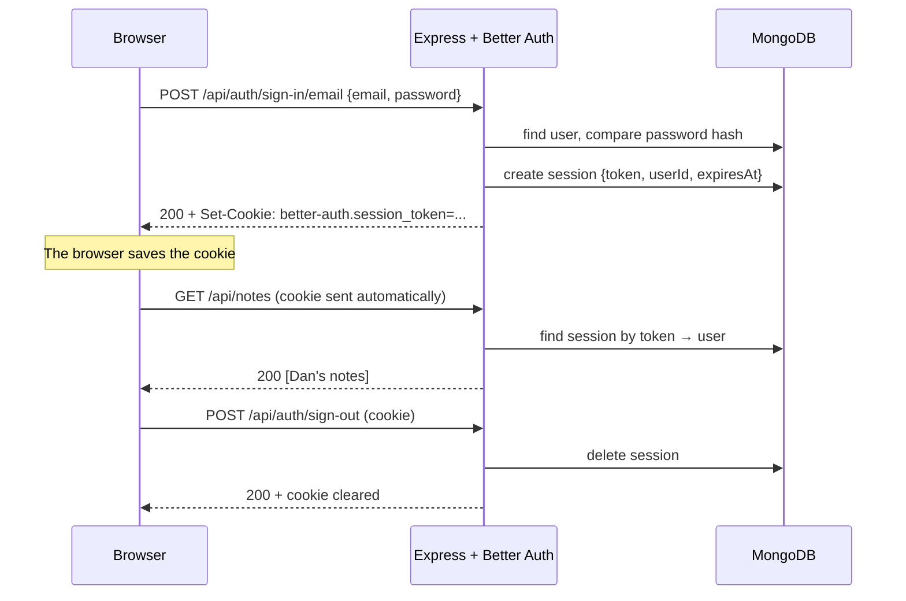

# 1. איך עובדת ההזדהות במערכת

[הבא: צד השרת ←](02-backend.md) · [English](../en/01-how-auth-works.md)

הדף הזה מסביר את הרעיונות. הדפים הבאים מראים את הקוד.

## שתי שאלות שונות

| מונח                        | השאלה                   | דוגמה                                  | תשובה שלילית ← |
| --------------------------- | ----------------------- | -------------------------------------- | -------------- |
| **אימות (Authentication)**  | *מי אתה?*               | התחברות עם אימייל וסיסמה               | `401 Unauthorized` |
| **הרשאה (Authorization)**   | *מה מותר לך לעשות?*     | רק מנהל רשאי להעביר פתק לארכיון        | `403 Forbidden`    |

קודם השרת מברר **מי** שלח את הבקשה. אחר כך הוא מחליט אם המשתמש הזה
**רשאי** לעשות את מה שביקש.

## החלקים במערכת

```
Browser (React)                Vite dev server            Express (port 3000)            MongoDB
───────────────                ───────────────            ───────────────────            ───────
authClient.signIn.email() ──▶  /api/* is forwarded  ──▶   /api/auth/*  → Better Auth ──▶  user, account,
fetch('/api/notes')       ──▶  to port 3000         ──▶   /api/notes   → requireAuth      session
```

- **Better Auth** היא הספרייה שעושה את החלקים הקשים: הרשמה, הצפנת סיסמאות
  (hash), יצירת sessions, עוגיות (cookies) ותפקידים. אנחנו רק מגדירים אותה, ולא
  כותבים את הלוגיקה הזו בעצמנו.
- **Better Auth בצד השרת** (`backend/src/lib/auth.js`) מטפלת בכל כתובת
  שמתחילה ב־`/api/auth/`.
- **Better Auth בצד הלקוח** (`frontend/src/lib/auth-client.js`) נותנת ל־React
  פונקציות כמו `signIn.email()` ו־hooks כמו `useSession()`, שקוראים לכתובות
  האלה בשבילכם.

## סיסמאות לא נשמרות אף פעם

כשמשתמש נרשם, Better Auth **לא** שומרת את הסיסמה. היא שומרת **hash**: תוצאה
של פונקציה חד־כיוונית (scrypt) שאי אפשר להפוך בחזרה.

```
"password1234"  ──scrypt + random salt──▶  "a3f9...:7c1e..."   (stored)
```

בהתחברות, הסיסמה שהמשתמש הקליד עוברת hash שוב ומושווית ל־hash השמור. גם מי
שגונב את מסד הנתונים לא יכול לקרוא את הסיסמאות. זו בדיוק הדרישה בהנחיות
הפרויקט: "סיסמאות מוצפנות, אין לשמור סיסמאות בטקסט גלוי".

## Sessions ועוגיות (Cookies)

פרוטוקול HTTP לא זוכר כלום בין בקשות, כי כל בקשה מגיעה לבד. אז איך השרת יודע
שהבקשה ל־`/api/notes` הגיעה מדן, שהתחבר לפני דקה?

1. כשדן מתחבר, השרת יוצר **session**: מסמך באוסף `session` שמכיל **טוקן**
   אקראי וארוך, את ה־id של דן ותאריך תפוגה.
2. השרת שולח את הטוקן חזרה בתוך **עוגייה** בשם `better-auth.session_token`.
3. הדפדפן שומר את העוגייה **ומצרף אותה אוטומטית לכל בקשה הבאה** לאותו אתר.
4. בכל בקשה השרת קורא את הטוקן מהעוגייה, מוצא את ה־session במסד הנתונים,
   וכך יודע מי המשתמש.



### העוגייה מוגנת

| הגדרה            | המשמעות                                                                      |
| ---------------- | ---------------------------------------------------------------------------- |
| `HttpOnly`       | קוד JavaScript בדף **לא יכול לקרוא** את העוגייה, כך שסקריפט זדוני לא יכול לגנוב אותה. |
| `SameSite=Lax`   | אתרים אחרים לא יכולים לגרום לדפדפן לשלוח אותה עם הבקשות שלהם.                |
| חתומה            | הערך חתום עם `BETTER_AUTH_SECRET`, ועוגייה מזויפת נדחית.                     |
| תוקף של 7 ימים   | session תקף 7 ימים ומוארך (לכל היותר פעם ביום) כל עוד המשתמש פעיל.           |

בגלל `HttpOnly`, **אתם אף פעם לא מטפלים בטוקן בעצמכם** ב־React: לא שומרים אותו
ב־`localStorage` ולא מוסיפים headers. הדפדפן עושה את זה לבד.

## למה ה־proxy של Vite חשוב

הדפדפן שולח עוגייה רק לאתר שיצר אותה. בזמן פיתוח ה־frontend רץ על פורט 5173
וה־backend על 3000, ואלה שני אתרים שונים.

הקובץ `frontend/vite.config.js` מעביר כל בקשה שמתחילה ב־`/api` מפורט 5173
לפורט 3000. הדפדפן מדבר רק עם `localhost:5173`, ולכן העוגיות פשוט עובדות
ואפשר לכתוב `fetch('/api/notes')` בלי שום הגדרה נוספת.

## מה יש במסד הנתונים

Better Auth יוצרת את האוספים האלה. **אל תערכו אותם ידנית**; השתמשו בפונקציות
של Better Auth.

| אוסף           | מה הוא מכיל                                                     |
| -------------- | --------------------------------------------------------------- |
| `user`         | `name`, `email`, `role`, `banned`, `createdAt`...                |
| `account`      | איך המשתמש מתחבר. בהתחברות עם אימייל: ה־hash של הסיסמה.         |
| `session`      | מסמך לכל דפדפן מחובר: `token`, `userId`, `expiresAt`.            |
| `verification` | טוקנים זמניים (אימות אימייל, איפוס סיסמה). לא בשימוש כאן.       |

האוספים שלכם (notes, incidents...) מצביעים על משתמשים עם `ref: "User"`.
ראו `backend/src/models/user.model.js`.

## תפקידים (Roles)

לכל משתמש יש שדה `role`. בפרויקט הבסיס יש שני תפקידים: `member` (ברירת המחדל
לכל מי שנרשם) ו־`manager`. בפרויקט שלכם תשנו את השמות, ראו
[04-recipes-and-faq.md](04-recipes-and-faq.md).

משתמשים בתפקיד בשני מקומות:

- **בשרת**: כאן מחליטים מה מותר. זו ההגנה האמיתית.
- **בממשק**: כאן מסתירים קישורים וכפתורים שהמשתמש לא יכול להשתמש בהם. זו רק
  נוחות. כל אחד יכול לקרוא ל־API ישירות, למשל עם קובצי ה־`.http`, ולכן השרת
  חייב לבדוק תמיד.

> **כלל אצבע:** אם ההגנה היחידה היא הסתרת כפתור ב־React, סטודנט עם REST Client
> עדיין יכול לבצע את הפעולה. כל כלל מסוג "רק X יכול..." בהנחיות שלכם צריך
> בדיקה **בשרת**.

## סיכום

- Better Auth מטפלת בהרשמה, התחברות, התנתקות, הצפנת סיסמאות, sessions ותפקידים.
- התחברות יוצרת session, והטוקן שלו נשמר בעוגיית `HttpOnly`.
- הדפדפן שולח את העוגייה בכל בקשה, והשרת מתרגם אותה בחזרה למשתמש.
- `401` = לא מחובר, `403` = מחובר אבל אין הרשאה.
- הממשק מסתיר, השרת אוכף.
