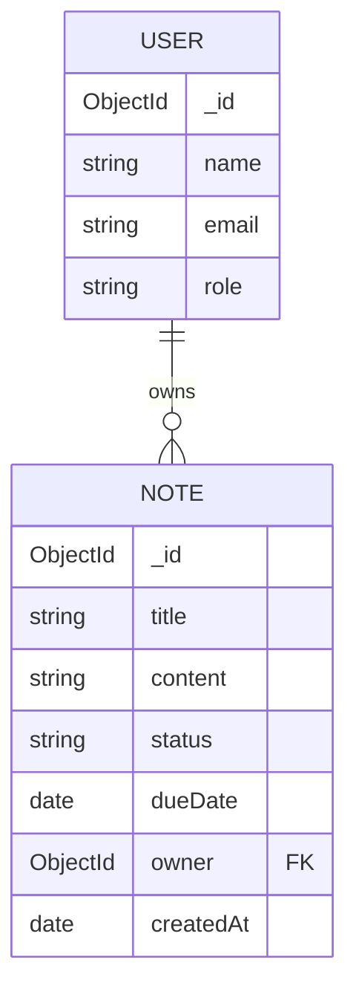

# 4. Seed data, tools and FAQ

[← Queries](03-queries.md) · [Back to the index](../README.md) · [עברית](../he/04-seed-tools-and-faq.md)

## Demo data: `backend/src/seed.js`

```bash
cd backend
npm run seed
```

It does four things, in order:

1. **Deletes the whole database** (`dropDatabase()`), including users and sessions.
2. **Rebuilds the indexes** of the models listed in `appModels`.
3. **Creates the demo users** through Better Auth, so their passwords are hashed.
4. **Creates the demo data** (notes) owned by those users.

Run it whenever the data gets messy, after changing a model, or before a demo.
It refuses to run when `NODE_ENV=production`.

### Adding your own data

```js
// 1. Import the model and add it to appModels (so its indexes are rebuilt)
import { Equipment } from "./models/equipment.model.js";
const appModels = [Note, Equipment];

// 2. Create documents. Keep the results to reference them later.
const [arduino, camera] = await Equipment.create([
  { name: "Arduino kit #1" },
  { name: "Camera Canon M50" },
]);

// 3. Reference users and other documents by id
await Reservation.create({
  user: dan.id,
  equipment: arduino._id,
  startTime: new Date("2026-12-01T10:00"),
  endTime: new Date("2026-12-01T12:00"),
});
```

### Good demo data

Your brief asks for "clear demo data". Make the seed tell a story:

- Data for **every screen**, so nothing is empty during the demo.
- Data for **every status** (open, in progress, closed...).
- Data owned by **different users**, so permissions are visible.
- Cases for **every business rule**: a late loan, an expired post, an existing
  reservation to overlap with...
- Dates **relative to today** (`Date.now() + 3 * 24 * 60 * 60 * 1000`), so the
  data still makes sense next month.

## Looking inside the database

You will want to see what is actually stored. Pick one:

| Tool | What it is |
| ---- | ---------- |
| **MongoDB Compass** | A free desktop app from MongoDB. Connect with your `DATABASE_URL`, then browse, filter and edit documents. The easiest option. |
| **MongoDB for VS Code** | An extension that shows collections inside the editor. |
| **mongosh** | The command-line shell: `mongosh "mongodb://127.0.0.1:27017/express"`, then `db.notes.find()`. |

Use them to **look**. To **change** data, prefer your API or the seed.
Editing Better Auth's collections by hand (`user`, `session`, `account`) can
break sign-in.

## Drawing the ERD

Your project book needs an ERD. Draw one box per collection, with its fields,
and a line for every `ref`:



This is a Mermaid diagram: GitHub and many editors draw it from the text.
`||--o{` means "one to many". You can also use draw.io or dbdiagram.io.

---

## FAQ

### `ECONNREFUSED 127.0.0.1:27017` when starting the backend

MongoDB isn't running, or not at that address. Start MongoDB (or check your
Atlas address in `DATABASE_URL`) and run `npm run dev` again.

### `E11000 duplicate key error` / 409 "already exists"

A unique index was broken: you tried to save a value that must be unique and
already exists. If that's expected (the user tried a duplicate), the 409 is
correct. If it happens to seed data, check that your seed doesn't create the
same thing twice.

### `Cast to ObjectId failed for value "..."` / 400 "Invalid id"

The id in the URL isn't a valid 24-character ObjectId. Usually the frontend
sent `undefined` (e.g. `note._id` instead of `note.id`). Log the URL.

### My `find` returns nothing

- **A misspelled field** (`{ stauts: "open" }`): MongoDB looks for a field no
  document has. There is no error, just an empty result.
- **An `undefined` value** (`{ status: req.query.stauts }`): also matches
  nothing. Only add a field to the filter when it has a value (see "Building a
  filter step by step" in [03-queries.md](03-queries.md)).
- **The wrong value or type:** `"Open"` is not `"open"`.
- **In `aggregate()`:** did you convert ids with `new mongoose.Types.ObjectId(...)`?

### `populate` gives me `null`

The referenced document doesn't exist anymore (it was deleted, or the seed
re-created it with a new id). Run `npm run seed`, and use `?.` in React.

### An update saved an invalid value

`findOneAndUpdate` and `updateMany` don't validate unless you pass
`runValidators: true`. Or use load + `save()`, which always validates.

### The frontend shows `undefined` for `note.id`

You used `.lean()`, so the object has `_id` and no `id`. Add `id: doc._id`
when mapping, or remove `.lean()`.

### I changed a model, but old documents don't have the new field

MongoDB doesn't change existing documents when the schema changes. New
documents get the field (and its `default`); old ones don't. In development,
just run `npm run seed`.

### I added `unique: true` but duplicates are still saved

The index couldn't be built because duplicates already existed, or the app was
started before the change. Run `npm run seed` (it rebuilds indexes for
`appModels`).

### The date is one day off

Dates are stored in UTC. `"2026-12-01"` is midnight UTC, which can show as
the previous evening in some time zones if you format it with the time. Use
`formatDate()` for dates and `toDateInputValue()` for date inputs.

### Where is the `users` collection?

Better Auth calls it `user` (singular). See
[02-models.md](02-models.md#users-modelsusermodeljs).

### Should I use SQL (SQLite/PostgreSQL) instead?

The brief suggests SQLite or PostgreSQL, but the design requirements (tables,
PK/FK, relations, ERD) apply the same way to MongoDB, as this guide shows.
Choose one database and use it throughout, as the brief says.
