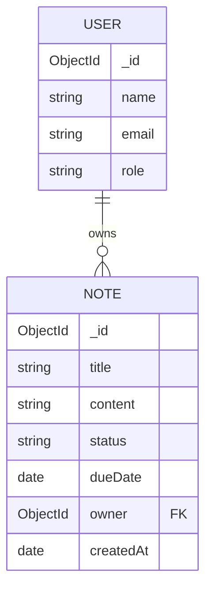

# 4. נתוני דמו, כלים ושאלות נפוצות

[→ שאילתות](03-queries.md) · [חזרה לתוכן העניינים](../README.md) · [English](../en/04-seed-tools-and-faq.md)

## נתוני דמו: `backend/src/seed.js`

```bash
cd backend
npm run seed
```

הסקריפט עושה ארבעה דברים, לפי הסדר:

1. **מוחק את כל מסד הנתונים** (`dropDatabase()`), כולל משתמשים ו־sessions.
2. **בונה מחדש את האינדקסים** של המודלים שברשימה `appModels`.
3. **יוצר את משתמשי הדמו** דרך Better Auth, כדי שהסיסמאות שלהם יעברו hash.
4. **יוצר את נתוני הדמו** (פתקים) ששייכים למשתמשים האלה.

הריצו אותו בכל פעם שהנתונים מתבלגנים, אחרי שינוי במודל, או לפני הדגמה. הוא
מסרב לרוץ כש־`NODE_ENV=production`.

### הוספת נתונים משלכם

```js
// 1. Import the model and add it to appModels (so its indexes are rebuilt)
import { Equipment } from "./models/equipment.model.js";
const appModels = [Note, Equipment];

// 2. Create documents. Keep the results to reference them later.
const [arduino, camera] = await Equipment.create([
  { name: "Arduino kit #1" },
  { name: "Camera Canon M50" },
]);

// 3. Reference users and other documents by id
await Reservation.create({
  user: dan.id,
  equipment: arduino._id,
  startTime: new Date("2026-12-01T10:00"),
  endTime: new Date("2026-12-01T12:00"),
});
```

### נתוני דמו טובים

ההנחיות מבקשות "נתוני דמו ברורים". דאגו שה־seed יספר סיפור:

- נתונים ל**כל מסך**, כדי ששום דבר לא יהיה ריק בהדגמה.
- נתונים ל**כל סטטוס** (פתוח, בטיפול, סגור...).
- נתונים ששייכים ל**משתמשים שונים**, כדי שההרשאות יהיו גלויות.
- מקרים ל**כל כלל עסקי**: השאלה באיחור, פרסום שפג תוקפו, הזמנה קיימת שאפשר
  לנסות לחפוף אליה...
- תאריכים **יחסית להיום** (`Date.now() + 3 * 24 * 60 * 60 * 1000`), כדי שהנתונים
  עדיין יהיו הגיוניים גם בחודש הבא.

## הצצה לתוך מסד הנתונים

תרצו לראות מה באמת נשמר. בחרו אחד מהכלים:

| כלי | מה זה |
| --- | ----- |
| **MongoDB Compass** | אפליקציית מחשב חינמית של MongoDB. מתחברים עם ה־`DATABASE_URL`, ואז אפשר לדפדף, לסנן ולערוך מסמכים. האפשרות הכי פשוטה. |
| **MongoDB for VS Code** | תוסף שמציג את האוספים בתוך העורך. |
| **mongosh** | מעטפת שורת הפקודה: `mongosh "mongodb://127.0.0.1:27017/express"`, ואז `db.notes.find()`. |

השתמשו בהם כדי **להסתכל**. כדי **לשנות** נתונים, עדיף להשתמש ב־API שלכם או
ב־seed. עריכה ידנית של האוספים של Better Auth (`user`, `session`, `account`)
עלולה לשבור את ההתחברות.

## שרטוט ה־ERD

ספר הפרויקט צריך ERD. שרטטו תיבה לכל אוסף עם השדות שלו, וקו לכל `ref`:



זה תרשים Mermaid: GitHub ועורכים רבים מציירים אותו מתוך הטקסט. `||--o{`
פירושו "אחד לרבים". אפשר גם להשתמש ב־draw.io או ב־dbdiagram.io.

---

## שאלות נפוצות

### `ECONNREFUSED 127.0.0.1:27017` כשמפעילים את השרת

MongoDB לא רץ, או שהוא לא בכתובת הזו. הפעילו את MongoDB (או בדקו את כתובת
ה־Atlas ב־`DATABASE_URL`) והריצו שוב `npm run dev`.

### `E11000 duplicate key error` / 409 "already exists"

אינדקס ייחודי הופר: ניסיתם לשמור ערך שחייב להיות ייחודי וכבר קיים. אם זה צפוי
(המשתמש ניסה ליצור כפילות), ה־409 נכון. אם זה קורה בנתוני ה־seed, בדקו שה־seed
לא יוצר את אותו דבר פעמיים.

### `Cast to ObjectId failed for value "..."` / 400 "Invalid id"

ה־id בכתובת הוא לא ObjectId תקין של 24 תווים. בדרך כלל ה־frontend שלח
`undefined` (למשל `note._id` במקום `note.id`). הדפיסו את הכתובת ובדקו.

### ה־`find` שלי לא מחזיר כלום

- **שם שדה עם שגיאת כתיב** (`{ stauts: "open" }`): MongoDB מחפש שדה שאין לאף
  מסמך. אין שגיאה, רק תוצאה ריקה.
- **ערך `undefined`** (`{ status: req.query.stauts }`): גם זה לא מתאים לכלום.
  הוסיפו שדה למסנן רק כשיש לו ערך (ראו "בניית מסנן שלב אחר שלב"
  ב־[03-queries.md](03-queries.md)).
- **ערך או טיפוס שגוי:** `"Open"` זה לא `"open"`.
- **ב־`aggregate()`:** המרתם את ה־ids עם `new mongoose.Types.ObjectId(...)`?

### `populate` מחזיר לי `null`

המסמך המקושר כבר לא קיים (הוא נמחק, או שה־seed יצר אותו מחדש עם id חדש).
הריצו `npm run seed`, והשתמשו ב־`?.` ב־React.

### עדכון שמר ערך לא תקין

`findOneAndUpdate` ו־`updateMany` לא בודקים תקינות אלא אם מעבירים
`runValidators: true`. אפשר גם להשתמש בטעינה + `save()`, שתמיד בודק.

### ה־frontend מציג `undefined` עבור `note.id`

השתמשתם ב־`.lean()`, ולכן לאובייקט יש `_id` ואין `id`. הוסיפו `id: doc._id`
כשאתם ממפים, או הסירו את `.lean()`.

### שיניתי מודל, אבל למסמכים הישנים אין את השדה החדש

MongoDB לא משנה מסמכים קיימים כשהסכמה משתנה. מסמכים חדשים מקבלים את השדה (ואת
ה־`default` שלו), וישנים לא. בזמן פיתוח פשוט הריצו `npm run seed`.

### הוספתי `unique: true` אבל כפילויות עדיין נשמרות

האינדקס לא נבנה, כי כבר היו כפילויות, או שהאפליקציה עלתה לפני השינוי. הריצו
`npm run seed` (הוא בונה מחדש את האינדקסים של `appModels`).

### התאריך זז ביום

תאריכים נשמרים ב־UTC. `"2026-12-01"` הוא חצות UTC, ובאזורי זמן מסוימים הוא
עלול להופיע כערב של היום הקודם אם מציגים אותו עם שעה. השתמשו ב־`formatDate()`
לתאריכים וב־`toDateInputValue()` לשדות תאריך.

### איפה האוסף `users`?

Better Auth קוראת לו `user` (ביחיד). ראו
[02-models.md](02-models.md#משתמשים-modelsusermodeljs).

### כדאי להשתמש ב־SQL (SQLite/PostgreSQL) במקום?

ההנחיות מציעות SQLite או PostgreSQL, אבל דרישות התכנון (טבלאות, PK/FK, קשרים,
ERD) חלות באותה צורה על MongoDB, כמו שהמדריך הזה מראה. בחרו מסד נתונים אחד
והתמידו בו, כמו שכתוב בהנחיות.
