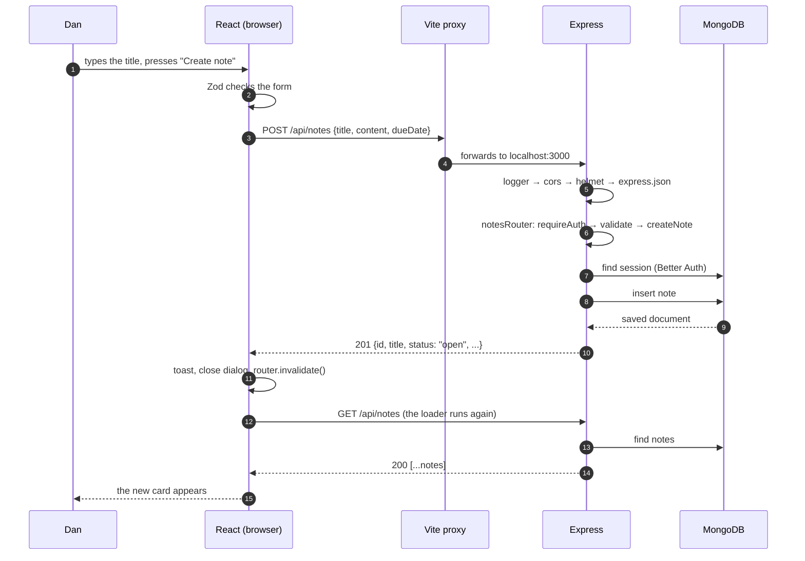

# 1. The journey of a request

[Next: Express and REST →](02-express-and-rest.md) · [עברית](../he/01-the-journey.md)

The other guides explain one part each. This page follows **one click** through
the whole system, so you can see how the parts connect. It's also the best
preparation for the defense: if you can explain this page using your own
project, you understand your project.

## The scenario

Dan is signed in, opens the Notes page, clicks **New note**, types
"Call the technician" and presses **Create note**.



Now step by step, with the code that runs at each one.

---

## Part A: in the browser

### 1. The form checks the input

`components/notes/note-form.jsx`

```js
validators: { onChange: noteSchema, onSubmit: noteSchema },
```

If the title were shorter than 3 characters, the error would show right away
and **nothing would be sent**. The title is fine, so the form's `onSubmit` runs
and prepares the data:

```js
const data = {
  title: value.title,            // "Call the technician"
  content: value.content,        // ""
  dueDate: value.dueDate || null // null
}
const error = await onSubmit(data)
```

→ [Forms guide](../../forms/en/01-how-forms-work.md)

### 2. The page sends the request

`components/notes/new-note-dialog.jsx`

```js
const response = await fetch('/api/notes', {
  method: 'POST',
  headers: { 'Content-Type': 'application/json' },
  body: JSON.stringify(data),
})
```

The browser builds an HTTP request:

```http
POST /api/notes HTTP/1.1
Host: localhost:5173
Content-Type: application/json
Cookie: better-auth.session_token=7Hq2...

{"title":"Call the technician","content":"","dueDate":null}
```

Three things to notice:

- **Method + URL** (`POST /api/notes`) say *what* to do: create a note.
- **Body**: the data, as JSON text.
- **Cookie**: the browser added the session cookie **by itself**. Our code
  never touched it.

### 3. Vite forwards it

The page was loaded from `localhost:5173`, so that's where the request goes.
`frontend/vite.config.js` forwards everything that starts with `/api`:

```js
proxy: {
  '/api': 'http://localhost:3000',
},
```

The request arrives at Express on port 3000, unchanged, cookie included.

→ [Why the proxy matters](../../auth/en/01-how-auth-works.md#why-the-vite-proxy-matters)

---

## Part B: in Express

### 4. The global middleware

`backend/src/app.js` runs these in order, for **every** request:

```js
app.use(expressLogger({ format: "dev" }));   // a. log the request
app.use(cors({ origin: clientUrl, credentials: true }));  // b. allow the frontend's origin
app.use(helmet());                            // c. add security headers to the response
app.all("/api/auth/*splat", toNodeHandler(auth));  // d. not /api/auth → skipped
app.use(express.json());                      // e. parse the JSON body into req.body
app.use("/api/notes", notesRouter);           // f. URL starts with /api/notes → go in
```

After step **e**, the body is a JavaScript object:

```js
req.body = { title: "Call the technician", content: "", dueDate: null }
```

### 5. The router picks the route

`backend/src/routes/notes.routes.js`

```js
notesRouter.use(requireAuth);
// ...
notesRouter.post("/", validate("body", createNoteBody), createNote);
```

Inside the router the URL is `/` (the `/api/notes` part was used by `app.use`),
and the method is `POST`, so this line matches. Its functions run left to right:
`requireAuth` → `validate` → `createNote`.

### 6. `requireAuth`: who is this?

`backend/src/middleware/auth.js`

```js
const session = await auth.api.getSession({ headers: fromNodeHeaders(req.headers) });
if (!session) throw httpError(401, "You must be signed in.");
req.user = session.user;
next();
```

Better Auth reads the token from the cookie and finds the session in MongoDB.
Now `req.user` is Dan:

```js
req.user = { id: "6aef...b89", name: "Dan Member", role: "member", ... }
```

`next()` moves to the next function.

→ [Auth guide: the backend](../../auth/en/02-backend.md)

### 7. `validate`: is the data allowed?

`backend/src/middleware/validate.js` + `backend/src/schemas/note.schemas.js`

```js
req.valid.body = createNoteBody.parse(req.body);
```

The **same rules** as in the browser, checked again, because anyone can send a
request without our React app. Unknown fields (like a `status` or `owner` sent
by a sneaky client) are **dropped**: `createNoteBody` doesn't list them.

### 8. The controller does the work

`backend/src/controllers/notes.controller.js`

```js
export async function createNote(req, res) {
  const note = await Note.create({
    ...req.valid.body,
    owner: req.user.id,   // from the session, not from the client
    status: "open",       // business rule: always starts open
  });

  await note.populate("owner", "name email");
  res.status(201).json(note);
}
```

This is where the **business rules** live: the owner comes from the session,
and the status is always `"open"`.

### 9. Mongoose and MongoDB save it

`Note.create()` applies the model's rules (`backend/src/models/note.model.js`):
required fields, defaults, the unique index on `owner + title`. Then MongoDB
stores the document:

```js
{
  _id: ObjectId("6af0...e12"),
  title: "Call the technician",
  content: "",
  status: "open",
  dueDate: null,
  owner: ObjectId("6aef...b89"),
  createdAt: ISODate("2026-11-08T10:15:00Z"),
  updatedAt: ISODate("2026-11-08T10:15:00Z")
}
```

→ [Database guide](../../database/README.md)

### 10. The response goes back

`res.status(201).json(note)` turns the document into JSON (`_id` becomes `id`)
and sends:

```http
HTTP/1.1 201 Created
Content-Type: application/json

{"id":"6af0...e12","title":"Call the technician","content":"","status":"open","dueDate":null,
 "owner":{"id":"6aef...b89","name":"Dan Member","email":"member@demo.com"},
 "createdAt":"2026-11-08T10:15:00.000Z","updatedAt":"2026-11-08T10:15:00.000Z"}
```

The logger from step 4a prints one line in the backend terminal:

```
POST /api/notes 201 14.000 ms
```

---

## Part C: back in the browser

### 11. The page reacts

`components/notes/new-note-dialog.jsx`

```js
if (!response.ok) return response.json()   // not taken: 201 is ok

toast.success('Note created')              // green message
setOpen(false)                             // close the dialog
await router.invalidate()                  // reload the page's data
```

### 12. The loader fetches the list again

`router.invalidate()` re-runs the loader of the Notes page
(`routes/dashboard/notes/index.jsx`):

```js
loader: async ({ deps }) => {
  const response = await fetch('/api/notes')
  // ...
}
```

That's a **second, separate request**, `GET /api/notes`, which goes through
steps 2–10 again: proxy → middleware → `requireAuth` → `listNotes`, which
returns only Dan's notes → `200` with the list.

→ [Routing guide: after a change](../../routing/en/02-loading-data.md#after-a-change-routerinvalidate)

### 13. React draws the new card

The component reads the fresh list with `Route.useLoaderData()`, and the new
card appears in the grid.

**One click, two HTTP requests, about 13 steps, all in a fraction of a second.**

---

## The same journey, when something goes wrong

Dan tries to create a second note with the same title.

| Step | What happens |
| ---- | ------------ |
| 1 | The form is valid (the browser doesn't know about other notes) |
| 2–7 | Same as before |
| 8 | `Note.create()` is called |
| 9 | MongoDB refuses: the unique index on `owner + title` is broken (error `E11000`) |
| — | The error is **thrown**. Express 5 skips everything else and jumps to `onError` |
| 10 | `onError` recognises code `11000` and sends `409 {"message":"A record with the same owner, title already exists."}` |
| 11 | `response.ok` is `false` → `return response.json()` → the form shows the message in `<ServerError>` |
| 12–13 | Not reached: the dialog stays open, so Dan can fix the title |

Where each kind of failure stops the journey:

| Failure | Stopped at | Response |
| ------- | ---------- | -------- |
| Title too short | Step 1, the browser (and step 7 if the browser is bypassed) | No request / `400` |
| Not signed in | Step 6, `requireAuth` | `401` |
| Wrong role | `requireRole` in the router | `403` |
| Not the owner | The controller (`findAccessibleNote`) | `403` |
| Doesn't exist | The controller | `404` |
| Business rule broken | The controller, or a unique index in step 9 | `409` |
| Bug in your code | Anywhere | `500`, with the stack trace in the backend terminal |
| URL doesn't exist | `notFound`, after all routes | `404 Route not found` |

## Watching it happen

You can see every step yourself:

- **Browser → DevTools → Network tab.** Click a request to see its method, URL,
  status, request body (*Payload*) and response (*Response*).
- **The backend terminal.** One line per request, with its status and time.
  Errors with status 500 print the full stack trace.
- **MongoDB Compass.** Refresh the `notes` collection to see the new document.
- **`backend/docs/notes.http`.** Send the same requests without the frontend,
  to tell whether a bug is in React or in Express.

## Explaining it in the defense

Use your own project and one important action (e.g. *"a student books
equipment"*). Be ready to answer:

1. Which component sends the request, and what does the request look like?
2. How does the server know who sent it?
3. Which middleware runs, in what order, and what can each one reject?
4. Where exactly is your business rule checked? Show the line.
5. What is stored in the database, and how is it related to other collections?
6. What does the response look like, and what does the frontend do with it?
7. What happens if the rule is broken? Show it live.
