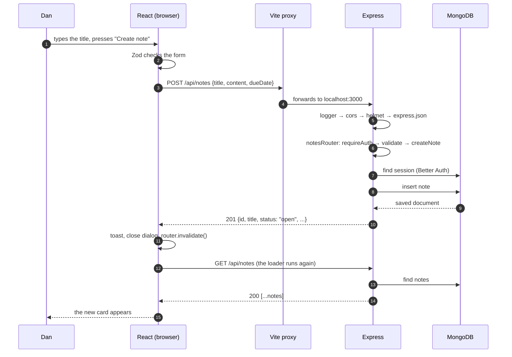

# 1. המסע של בקשה

[הבא: Express ו־REST ←](02-express-and-rest.md) · [English](../en/01-the-journey.md)

כל אחד מהמדריכים האחרים מסביר חלק אחד. הדף הזה עוקב אחרי **לחיצה אחת** לאורך
כל המערכת, כדי שתראו איך החלקים מתחברים. זו גם ההכנה הכי טובה להגנה: אם אתם
יכולים להסביר את הדף הזה על הפרויקט שלכם, אתם מבינים את הפרויקט שלכם.

## התרחיש

דן מחובר, פותח את דף הפתקים, לוחץ על **New note**, מקליד "Call the technician"
ולוחץ על **Create note**.



עכשיו שלב אחר שלב, עם הקוד שרץ בכל שלב.

---

## חלק א: בדפדפן

### 1. הטופס בודק את הקלט

`components/notes/note-form.jsx`

```js
validators: { onChange: noteSchema, onSubmit: noteSchema },
```

אם הכותרת הייתה קצרה מ־3 תווים, השגיאה הייתה מופיעה מיד ו**שום דבר לא היה
נשלח**. הכותרת תקינה, ולכן ה־`onSubmit` של הטופס רץ ומכין את הנתונים:

```js
const data = {
  title: value.title,            // "Call the technician"
  content: value.content,        // ""
  dueDate: value.dueDate || null // null
}
const error = await onSubmit(data)
```

← [מדריך הטפסים](../../forms/he/01-how-forms-work.md)

### 2. הדף שולח את הבקשה

`components/notes/new-note-dialog.jsx`

```js
const response = await fetch('/api/notes', {
  method: 'POST',
  headers: { 'Content-Type': 'application/json' },
  body: JSON.stringify(data),
})
```

הדפדפן בונה בקשת HTTP:

```http
POST /api/notes HTTP/1.1
Host: localhost:5173
Content-Type: application/json
Cookie: better-auth.session_token=7Hq2...

{"title":"Call the technician","content":"","dueDate":null}
```

שלושה דברים ששווה לשים לב אליהם:

- **Method + URL** (`POST /api/notes`) אומרים *מה* לעשות: ליצור פתק.
- **הגוף (body)**: הנתונים, כטקסט JSON.
- **Cookie**: הדפדפן הוסיף את עוגיית ה־session **בעצמו**. הקוד שלנו לא נגע בה.

### 3. Vite מעביר אותה הלאה

הדף נטען מ־`localhost:5173`, ולכן הבקשה נשלחת לשם. `frontend/vite.config.js`
מעביר כל מה שמתחיל ב־`/api`:

```js
proxy: {
  '/api': 'http://localhost:3000',
},
```

הבקשה מגיעה ל־Express בפורט 3000 בלי שינוי, כולל העוגייה.

← [למה ה־proxy חשוב](../../auth/he/01-how-auth-works.md#למה-הproxy-של-vite-חשוב)

---

## חלק ב: ב־Express

### 4. ה־middleware הכללי

`backend/src/app.js` מריץ את אלה לפי הסדר, עבור **כל** בקשה:

```js
app.use(expressLogger({ format: "dev" }));   // a. log the request
app.use(cors({ origin: clientUrl, credentials: true }));  // b. allow the frontend's origin
app.use(helmet());                            // c. add security headers to the response
app.all("/api/auth/*splat", toNodeHandler(auth));  // d. not /api/auth → skipped
app.use(express.json());                      // e. parse the JSON body into req.body
app.use("/api/notes", notesRouter);           // f. URL starts with /api/notes → go in
```

אחרי שלב **e**, הגוף הוא אובייקט JavaScript:

```js
req.body = { title: "Call the technician", content: "", dueDate: null }
```

### 5. ה־router בוחר נתיב

`backend/src/routes/notes.routes.js`

```js
notesRouter.use(requireAuth);
// ...
notesRouter.post("/", validate("body", createNoteBody), createNote);
```

בתוך ה־router הכתובת היא `/` (החלק `/api/notes` כבר נוצל ב־`app.use`), והמתודה
היא `POST`, ולכן השורה הזו מתאימה. הפונקציות שלה רצות לפי הסדר:
`requireAuth` ← `validate` ← `createNote`.

### 6. `requireAuth`: מי זה?

`backend/src/middleware/auth.js`

```js
const session = await auth.api.getSession({ headers: fromNodeHeaders(req.headers) });
if (!session) throw httpError(401, "You must be signed in.");
req.user = session.user;
next();
```

Better Auth קוראת את הטוקן מהעוגייה ומוצאת את ה־session ב־MongoDB. עכשיו
`req.user` הוא דן:

```js
req.user = { id: "6aef...b89", name: "Dan Member", role: "member", ... }
```

`next()` עובר לפונקציה הבאה.

← [מדריך ההזדהות: צד השרת](../../auth/he/02-backend.md)

### 7. `validate`: האם הנתונים מותרים?

`backend/src/middleware/validate.js` + `backend/src/schemas/note.schemas.js`

```js
req.valid.body = createNoteBody.parse(req.body);
```

**אותם כללים** כמו בדפדפן נבדקים שוב, כי כל אחד יכול לשלוח בקשה בלי אפליקציית
ה־React שלנו. שדות לא מוכרים (כמו `status` או `owner` שלקוח ערמומי שלח)
**מושמטים**, כי `createNoteBody` לא מכיר אותם.

### 8. ה־controller עושה את העבודה

`backend/src/controllers/notes.controller.js`

```js
export async function createNote(req, res) {
  const note = await Note.create({
    ...req.valid.body,
    owner: req.user.id,   // from the session, not from the client
    status: "open",       // business rule: always starts open
  });

  await note.populate("owner", "name email");
  res.status(201).json(note);
}
```

כאן גרים **הכללים העסקיים**: הבעלים נלקח מה־session, והסטטוס הוא תמיד `"open"`.

### 9. Mongoose ו־MongoDB שומרים

`Note.create()` מפעיל את הכללים של המודל (`backend/src/models/note.model.js`):
שדות חובה, ערכי ברירת מחדל, והאינדקס הייחודי על `owner + title`. אחר כך MongoDB
שומר את המסמך:

```js
{
  _id: ObjectId("6af0...e12"),
  title: "Call the technician",
  content: "",
  status: "open",
  dueDate: null,
  owner: ObjectId("6aef...b89"),
  createdAt: ISODate("2026-11-08T10:15:00Z"),
  updatedAt: ISODate("2026-11-08T10:15:00Z")
}
```

← [מדריך מסד הנתונים](../../database/README.md)

### 10. התשובה חוזרת

`res.status(201).json(note)` הופך את המסמך ל־JSON (`_id` הופך ל־`id`) ושולח:

```http
HTTP/1.1 201 Created
Content-Type: application/json

{"id":"6af0...e12","title":"Call the technician","content":"","status":"open","dueDate":null,
 "owner":{"id":"6aef...b89","name":"Dan Member","email":"member@demo.com"},
 "createdAt":"2026-11-08T10:15:00.000Z","updatedAt":"2026-11-08T10:15:00.000Z"}
```

ה־logger משלב 4a מדפיס שורה אחת בטרמינל של השרת:

```
POST /api/notes 201 14.000 ms
```

---

## חלק ג: חזרה לדפדפן

### 11. הדף מגיב

`components/notes/new-note-dialog.jsx`

```js
if (!response.ok) return response.json()   // not taken: 201 is ok

toast.success('Note created')              // green message
setOpen(false)                             // close the dialog
await router.invalidate()                  // reload the page's data
```

### 12. ה־loader טוען שוב את הרשימה

`router.invalidate()` מריץ מחדש את ה־loader של דף הפתקים
(`routes/dashboard/notes/index.jsx`):

```js
loader: async ({ deps }) => {
  const response = await fetch('/api/notes')
  // ...
}
```

זו **בקשה שנייה ונפרדת**, `GET /api/notes`, שעוברת שוב את שלבים 2–10: proxy ←
middleware ← `requireAuth` ← `listNotes`, שמחזיר רק את הפתקים של דן ← `200` עם
הרשימה.

← [מדריך הניתוב: אחרי שינוי](../../routing/he/02-loading-data.md#אחרי-שינוי-routerinvalidate)

### 13. React מצייר את הכרטיס החדש

הקומפוננטה קוראת את הרשימה העדכנית עם `Route.useLoaderData()`, והכרטיס החדש
מופיע ברשת.

**לחיצה אחת, שתי בקשות HTTP, בערך 13 שלבים, והכול בשבריר שנייה.**

---

## אותו מסע, כשמשהו משתבש

דן מנסה ליצור פתק שני עם אותה כותרת.

| שלב | מה קורה |
| --- | ------- |
| 1 | הטופס תקין (הדפדפן לא יודע על פתקים אחרים) |
| 2–7 | כמו קודם |
| 8 | קוראים ל־`Note.create()` |
| 9 | MongoDB מסרב: האינדקס הייחודי על `owner + title` הופר (שגיאה `E11000`) |
| — | השגיאה **נזרקת**. Express 5 מדלג על כל השאר וקופץ ל־`onError` |
| 10 | `onError` מזהה את הקוד `11000` ושולח `409 {"message":"A record with the same owner, title already exists."}` |
| 11 | `response.ok` הוא `false` ← `return response.json()` ← הטופס מציג את ההודעה ב־`<ServerError>` |
| 12–13 | לא מגיעים אליהם: הדיאלוג נשאר פתוח, כך שדן יכול לתקן את הכותרת |

איפה כל סוג של כישלון עוצר את המסע:

| כישלון | נעצר ב־ | תשובה |
| ------ | ------- | ----- |
| כותרת קצרה מדי | שלב 1, בדפדפן (ובשלב 7 אם עוקפים את הדפדפן) | אין בקשה / `400` |
| לא מחובר | שלב 6, `requireAuth` | `401` |
| תפקיד לא מתאים | `requireRole` ב־router | `403` |
| לא הבעלים | ה־controller (`findAccessibleNote`) | `403` |
| לא קיים | ה־controller | `404` |
| הפרת כלל עסקי | ה־controller, או אינדקס ייחודי בשלב 9 | `409` |
| באג בקוד שלכם | בכל מקום | `500`, וה־stack trace בטרמינל של השרת |
| הכתובת לא קיימת | `notFound`, אחרי כל הנתיבים | `404 Route not found` |

## לראות את זה קורה

אפשר לראות כל שלב בעצמכם:

- **בדפדפן ← DevTools ← לשונית Network.** לחצו על בקשה כדי לראות את המתודה,
  הכתובת, הסטטוס, גוף הבקשה (*Payload*) והתשובה (*Response*).
- **הטרמינל של השרת.** שורה אחת לכל בקשה, עם הסטטוס והזמן. שגיאות עם סטטוס 500
  מדפיסות את ה־stack trace המלא.
- **MongoDB Compass.** רעננו את האוסף `notes` כדי לראות את המסמך החדש.
- **`backend/docs/notes.http`.** שלחו את אותן בקשות בלי ה־frontend, כדי להבין אם
  הבאג ב־React או ב־Express.

## להסביר את זה בהגנה

השתמשו בפרויקט שלכם ובפעולה חשובה אחת (למשל *"סטודנט מזמין ציוד"*). היו מוכנים
לענות:

1. איזו קומפוננטה שולחת את הבקשה, ואיך הבקשה נראית?
2. איך השרת יודע מי שלח אותה?
3. איזה middleware רץ, באיזה סדר, ומה כל אחד מהם יכול לדחות?
4. איפה בדיוק נבדק הכלל העסקי שלכם? הראו את השורה.
5. מה נשמר במסד הנתונים, ואיך זה קשור לאוספים אחרים?
6. איך נראית התשובה, ומה ה־frontend עושה איתה?
7. מה קורה אם מפרים את הכלל? הראו את זה בשידור חי.
